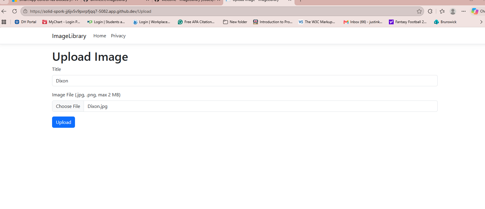
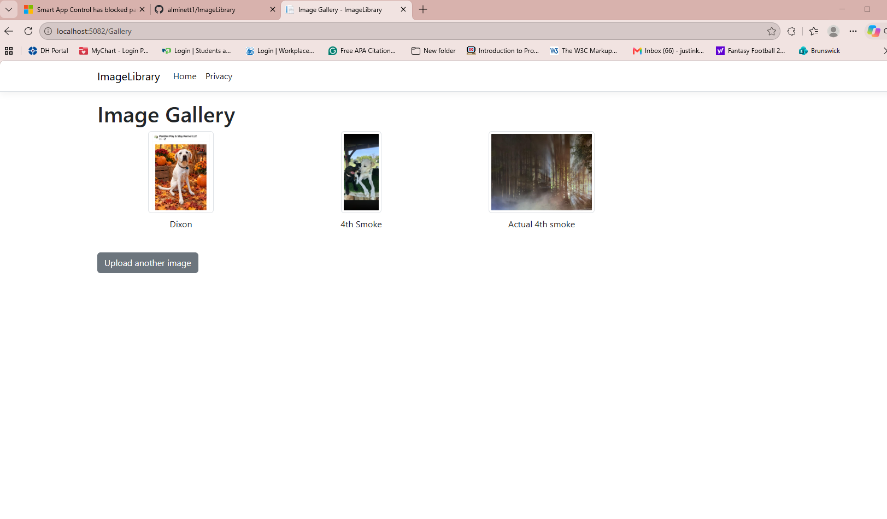
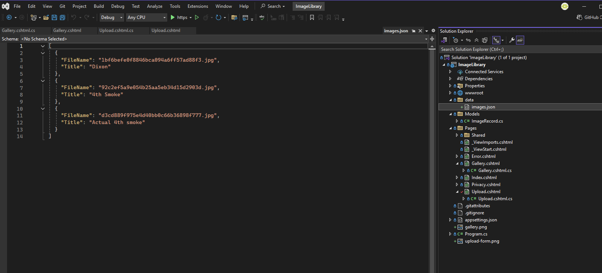

# ImageLibrary

An ASP.NET Core Razor Pages app for securely uploading images, validating them, and displaying them in a gallery.

## Features
- Upload form with a title and an image file
- Validation: only `.jpg`/`.png` files under 2 MB
- Anti-forgery token on the upload form
- Images saved to `wwwroot/uploads/` with unique file names
- Image metadata (title and file name) saved to `data/images.json`
- Gallery page showing thumbnails with titles

## How to Run
```
dotnet run
```
Then go to `/Upload` to add an image and `/Gallery` to view uploads.

## Screenshots

### Upload Form


### Validation Error


### Gallery


### Metadata (images.json)
